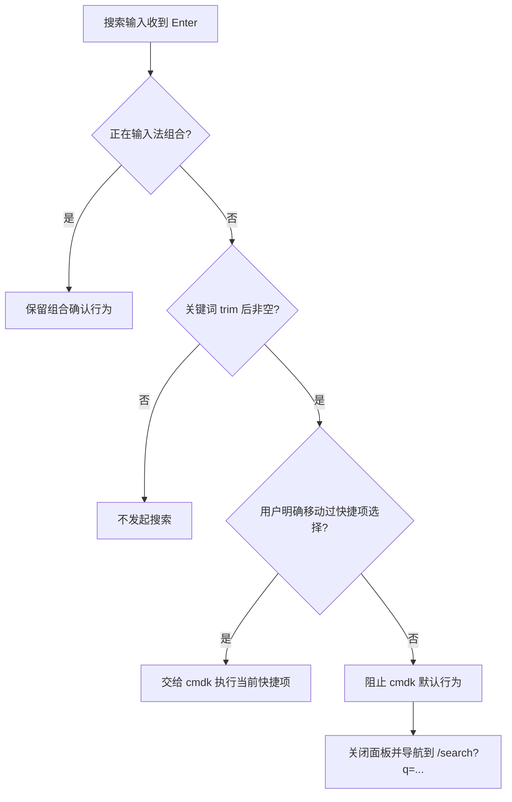

# Design

## Context

参见 `proposal.md` 的问题说明。页头 `CommandPalette` 同时承载两种操作：提交自由文本搜索，以及从 `cmdk` 列表执行快捷操作。当前输入框位于原生 `<form>` 内，但 `cmdk` 根组件在冒泡阶段对 Enter 调用 `preventDefault()`，导致表单 `onSubmit` 不运行；若筛选后存在隐式选中项，Enter 还会执行该项。

`/search` 是现有 feed archetype 路由，查询词由 URL `q` 参数驱动，随后调用既有 `/api/v1/search?q=...&engine=local`。本次设计保持该 URL 和请求边界不变。UI 继续复用 `Layout`、`FeedPage`、Field、Input、Button、Dialog 和 Command 组合，不修改 design token、响应式结构或 primitive API。

## Goals / Non-Goals

**Goals:**

- 在 `CommandPalette` consumer 层区分“直接提交搜索”和“明确选择快捷操作”。
- 让 Enter 和按钮提交共用同一套 trim、空值判断与 URL 构造规则。
- 在事件处理顺序中正确保护输入法组合文本。
- 用行为测试覆盖 `cmdk` 拦截 Enter 的真实集成路径，而不是只测试提交函数。

**Non-Goals:**

- 不改变搜索接口、结果数据、搜索范围、排序或错误反馈。
- 不把站内搜索语义写入通用 Command/Input primitive。
- 不升级、替换或 fork `cmdk`，也不新增搜索抽象层。

## Decisions

### 1. 在 CommandPalette consumer 层抢先处理搜索 Enter

在 `CommandPalette` 的 Command 事件边界观察键盘操作。当事件来自搜索输入、不是输入法组合状态、查询词非空，且用户没有通过方向键明确移动快捷项选择时，处理器将阻止 `cmdk` 的默认 Enter 行为并调用统一搜索提交函数。`cmdk` 会先调用 consumer 提供的键盘处理器，再检查 `defaultPrevented`，因此该边界可以避免隐式快捷项执行。

选择意图只由当前查询周期内的方向键导航建立；搜索词变化后重置。鼠标或触控直接激活 `CommandItem` 继续走现有 `onSelect`。

**拒绝的替代方案：**

- 只依赖 `<form onSubmit>`：`cmdk` 已经取消 Enter 默认行为，无法修复根因。
- 在输入框每次 Enter 都搜索：会破坏现有方向键选择快捷操作的键盘能力。
- 修改共享 `components/ui/command.tsx`：搜索优先是 CNode CommandPalette 的领域行为，写入 primitive 会影响其他 Command 使用者并违反 primitive ownership。
- 将“搜索关键词”渲染为动态 CommandItem：可以利用 `cmdk` 选择模型，但会改变列表结构、筛选排序和辅助技术播报，修复范围更大。

### 2. 搜索提交使用单一函数，表单作为可访问回退边界

CommandPalette 内部用一个提交函数完成 trim、空值判断、关闭面板和 React Router 导航；表单 `onSubmit` 与键盘拦截路径调用相同逻辑。`/search` 页面继续使用原生表单提交事件，使 Enter 和 Button `type="submit"` 进入同一个 handler。

URL 继续通过路由 API 写入 `q`，并在构造导航 URL 时编码查询值。不引入额外本地搜索状态或请求层改动。

**拒绝的替代方案：**

- 为 Enter 和按钮维护两个处理函数：容易产生 trim、空查询和 URL 编码差异。
- 使用 `window.location` 全页跳转：会丢失 React Router 客户端导航和现有 transition 行为。

### 3. IME 判断先于搜索和快捷操作判断

键盘处理器首先检查原生 composition 状态，并兼容浏览器用于组合输入的 key code。组合中的 Enter 不调用 `preventDefault()`、不关闭 overlay、不导航；组合结束后的下一次 Enter 才按普通规则处理。

**拒绝的替代方案：**

- 仅监听 `compositionend` 后设置延时状态：增加竞态和计时依赖，没有必要。
- 仅检查 React 合成事件字段：底层 `cmdk` 读取原生事件，统一参考原生 composition 状态更接近实际冲突点。

### 4. 测试覆盖事件竞争和两个入口的行为一致性

CommandPalette 测试使用真实 Command、输入框和 memory router：输入无匹配关键词按 Enter、输入可模糊匹配快捷项的关键词按 Enter、方向键明确选项后按 Enter、空查询，以及 composition Enter。搜索页测试验证 Enter 与按钮都更新 `q` 并触发同一查询。

视觉结构没有变化，因此不新增截图基线；实施验收仍在桌面和移动 viewport 检查 overlay、焦点、Escape、关闭控件及结果状态，并检查浏览器 console。

## Risks / Trade-offs

- [明确选择状态没有在查询变化时重置] → 在输入值变化、面板关闭和重新打开时重置，并用“方向键后继续输入再 Enter”的测试覆盖。
- [IME Enter 被误提交] → 在 consumer handler 最前检查 `nativeEvent.isComposing` 和兼容信号，并增加 composition 回归测试。
- [键盘快捷操作失效] → 保留方向键建立明确选择后由 `cmdk` 处理 Enter，并保留现有快捷操作测试。
- [事件处理依赖 `cmdk` 当前调用顺序] → 集成测试直接挂载真实 `cmdk@1.1.1`；不 mock Command primitive。未来升级依赖时同一测试将暴露变化。
- [额外选择意图状态增加复杂度] → 状态只存在于 CommandPalette，不进入全局 store 或通用 primitive。

## Migration Plan

1. 实施 Web consumer 行为和回归测试，不执行数据迁移或接口发布。
2. 运行目标测试、Web test/typecheck/build，并在可行时运行 `pnpm verify`。
3. 按 `cnode-deploy` 流程等待 CI 镜像构建完成、部署现有 Compose 服务，并验证生产健康状态。
4. 在生产环境分别验证无匹配关键词、可模糊匹配关键词、方向键快捷项、Escape/焦点恢复和移动端搜索。
5. 如出现回归，按现有部署流程回滚到前一个不可变镜像；无数据库或 API 回滚步骤。
