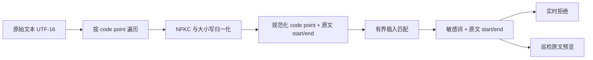
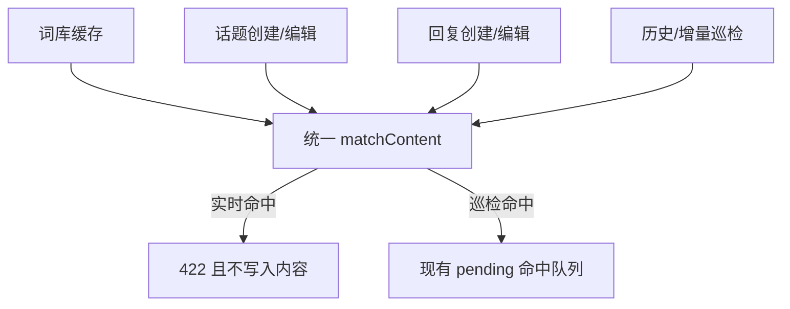

# Design

## Context

参见 `proposal.md` 的 Why。当前 `apps/api/src/lib/moderation.ts` 的 `matchContent()` 对原文与词条调用 `toLowerCase()` 后逐词执行 `indexOf()`；`checkContent()` 将结果用于实时拒绝，`apps/api/src/lib/moderation-scan.ts` 也调用同一函数检查历史话题和回复。因此中央匹配器是保持实时与巡检一致的现有边界。

当前 `ContentHit.index` 是 UTF-16 字符串下标，`createHitPreview()` 直接用它截取原文。NFKC、大小写转换、代理对和组合字符都可能改变规范化文本与原文的长度关系，不能先生成压缩字符串再把压缩下标当作原文下标。

现有词库逐词缓存在进程内 60 秒；词条表没有匹配模式字段。现有 `content-moderation` 规范还要求 10000 字内容的匹配低于 100ms，设计必须限制每个候选位置的前瞻范围。

## Goals / Non-Goals

**Goals:**

- 在一个纯匹配边界内覆盖连续文本、Unicode 兼容变体和已确认的任意类型插入字符绕过。
- 精确定义 3 个普通字符和 16 个总字符的相邻字符间边界。
- 为每次命中返回可安全用于原文预览的范围。
- 保持实时拒绝、巡检入队、命中计数和去重的现有调用关系。
- 通过有界扫描继续满足现有性能预算。

**Non-Goals:**

- 识别拼音、同音字、同形字或语义等价表达。
- 为单独词条提供匹配模式或阈值配置。
- 改变 API 错误结构、数据库结构或管理员处理流程。
- 保证所有可能的规避写法均可检测。

## Decisions

### 1. 构造带原文范围的 Unicode code point 视图

匹配器将内容和词条按 Unicode code point 处理。内容视图中的每个规范化 code point 保存其来源原文 UTF-16 范围；如果一个原文 code point 经 NFKC 或大小写折叠展开为多个 code point，这些输出项共享同一来源范围。命中返回首个和末个参与匹配项覆盖的原文半开区间 `[start, end)`。

对词条使用相同归一化，但不需要原文映射。空词条或归一化后为空的词条不参与匹配。

**未选择的方案：**

- 全文删除分隔符后 `indexOf()`：会丢失原文下标，并把远离的字符错误拼接。
- 继续使用 UTF-16 code unit 计数：Emoji 等补充平面字符会被算作两个字符，与确认的 Unicode code point 边界不一致。
- 先解析 Markdown：标题和回复也走相同匹配器，且 Markdown 解析会引入另一套位置映射和语义；原始提交文本上的有界规则已经覆盖标记插入。

### 2. 使用相邻词字符的有界前瞻匹配

对每个规范化内容位置尝试匹配词条首字符。匹配后续词条字符时，只在当前已匹配字符之后前瞻最多 17 个位置，从而允许最多 16 个插入 code point。候选路径记录两项计数：

| 计数       | 上限 | 计入字符                                                    |
| ---------- | ---: | ----------------------------------------------------------- |
| 普通插入数 |    3 | Unicode Letter (`L*`) 与 Number (`N*`)；汉字属于 Letter     |
| 总插入数   |   16 | 所有 Unicode code point，包括空白、格式、标点、符号和 Emoji |

目标敏感词字符本身不计入插入数。两个边界均为包含边界：3 和 16 可以命中，4 或 17 不可以命中。每匹配到一个敏感词字符，两项计数归零，再处理下一对相邻词字符。单字符敏感词不需要跨距判断，规范化字符相等即命中。

当某个前瞻位置等于下一目标字符时，匹配器优先沿该位置继续；若后续字符失败，还必须允许把该字符视为插入字符并继续寻找同一目标字符，只要计数未超限。该回溯范围受 16 个 code point 的硬边界限制，避免重复字符造成错误漏报。

**未选择的方案：**

- `科.*学` 式无限子序列：会让长文本中无关的“科”和“学”形成命中，且成本无明确上限。
- 只跳过空白和标点：不满足已确认的 `科a学`、`科1学` 和 `科测试学` 拦截要求。
- 编辑距离：会允许替换和删除词条字符，扩大到未确认的模糊匹配行为。
- AC 自动机：适合大词库连续匹配，但本次还需要有界插入、分类计数和原文映射；先保持现有逐词调用模型，性能数据表明需要时再单独设计索引。

### 3. `ContentHit` 扩展为原文范围，兼容现有消费者

命中对象保留 `word`、`keywordId` 和原文 `index`，并增加排他的原文结束位置。`index` 继续表示命中首字符的原文 UTF-16 下标，避免现有预览调用失效；巡检预览改为按完整范围构造，保证长插入变体不会落在固定半径之外。

同一词条在一个字段中仍只返回一次命中，与现有 `hit_count` “每次字段检查按词条去重”行为一致。多个词条按缓存词库顺序返回，避免无关 API 行为变化。巡检去重键继续基于目标、字段和命中词集合，不纳入具体绕过写法或位置。

**未选择的方案：**只返回规范化字符串下标，因为所有调用方都持有原文，且后台必须展示原始绕过字符。

### 4. 实时过滤与巡检只共享匹配器，不复制策略

`checkContent()` 和巡检批处理继续调用同一 `matchContent()`。路由仍按当前顺序检查标题和内容，命中后返回 `422`；巡检仍只创建待复核记录。匹配阈值定义在匹配模块内部，不通过环境变量或数据库配置暴露，避免不同进程或任务采用不同政策。

**未选择的方案：**在路由层预先清洗文本，因为会遗漏巡检路径并使匹配政策分叉。

### 5. 发布后复用现有手动全量巡检

代码发布与验证完成后，由获准管理员通过现有巡检入口创建 `scope=all`、`mode=historical` 的任务。任务使用部署后的统一匹配器，扫描未删除内容并仅产生待复核记录。不新增自动启动逻辑，避免每个实例启动时重复创建全量任务。

**未选择的方案：**修改数据库迁移或启动过程自动重扫，因为匹配规则变更不需要数据迁移，而且现有持久化巡检队列已经提供资源限制和任务控制。

## Risks / Trade-offs

- [Risk] 两字符敏感词在 3/16 边界内会命中更多普通文本 → 这是已确认的严格政策；以双边界限制范围，并用边界反例固定行为。
- [Risk] NFKC 或大小写展开导致位置映射错误 → 为全角字符、组合字符、代理对和展开字符添加映射测试，统一返回原文 UTF-16 半开区间。
- [Risk] 重复目标字符需要候选分支，朴素贪心会漏报 → 在单个 16-code-point 窗口内进行有界回溯，并添加重复字符测试。
- [Risk] 逐词有界扫描增加 CPU 成本 → 预归一化每段内容一次，预归一化缓存词条，并以 10000 字基准和现实词库规模验证低于 100ms。
- [Risk] 匹配范围扩展后历史重扫产生大量待处理项 → 复用现有批大小、限速、暂停和取消能力；历史命中不自动处置。
- [Trade-off] 插入 4 个 Letter/Number 或总计 17 个 code point 仍可绕过 → 该边界是误拒绝与覆盖率之间已确认的政策选择。
- [Trade-off] Unicode Mark (`M*`) 不计入 3 个普通字符，但计入 16 个总字符 → 组合标记通常是文字装饰；总跨度仍限制滥用。

## Migration Plan

1. 先部署匹配器、原文范围预览和自动化验证；不执行数据库迁移。
2. 观察实时请求错误率、匹配性能和 moderation worker 运行指标，日志与 trace 不得包含敏感词或正文。
3. 由获准管理员创建一次全量历史巡检任务，并通过现有任务页面观察进度、失败、暂停和取消状态。
4. 管理员按现有流程复核新增命中，不自动删除或隐藏内容。

回滚时恢复旧匹配器版本并取消尚未完成的全量任务。已经创建的巡检命中记录保留，管理员可按现有误报或忽略流程处理；无需回滚数据结构。

## Database Change Audit

本变更不修改 PostgreSQL schema、Drizzle migration、seed/bootstrap、索引、约束、字段语义、数据保留策略，也不执行 backfill、数据修复或清理。发布后的全量巡检是现有业务任务，会按现有模型新增待复核命中记录，不属于数据库迁移。
